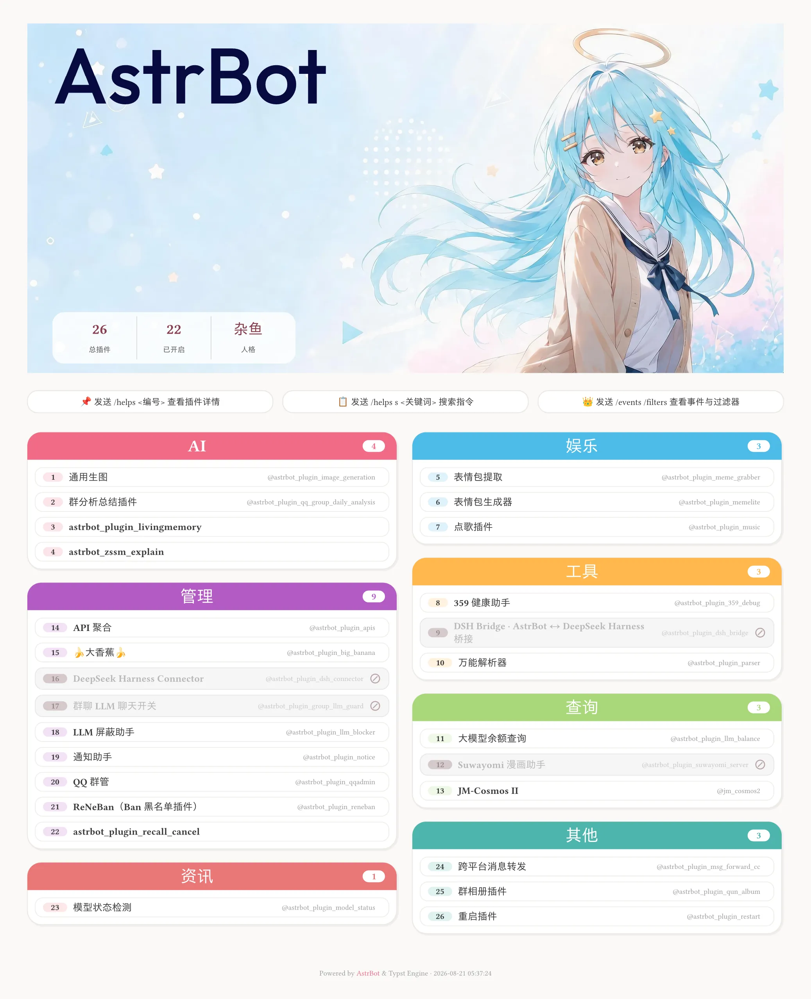
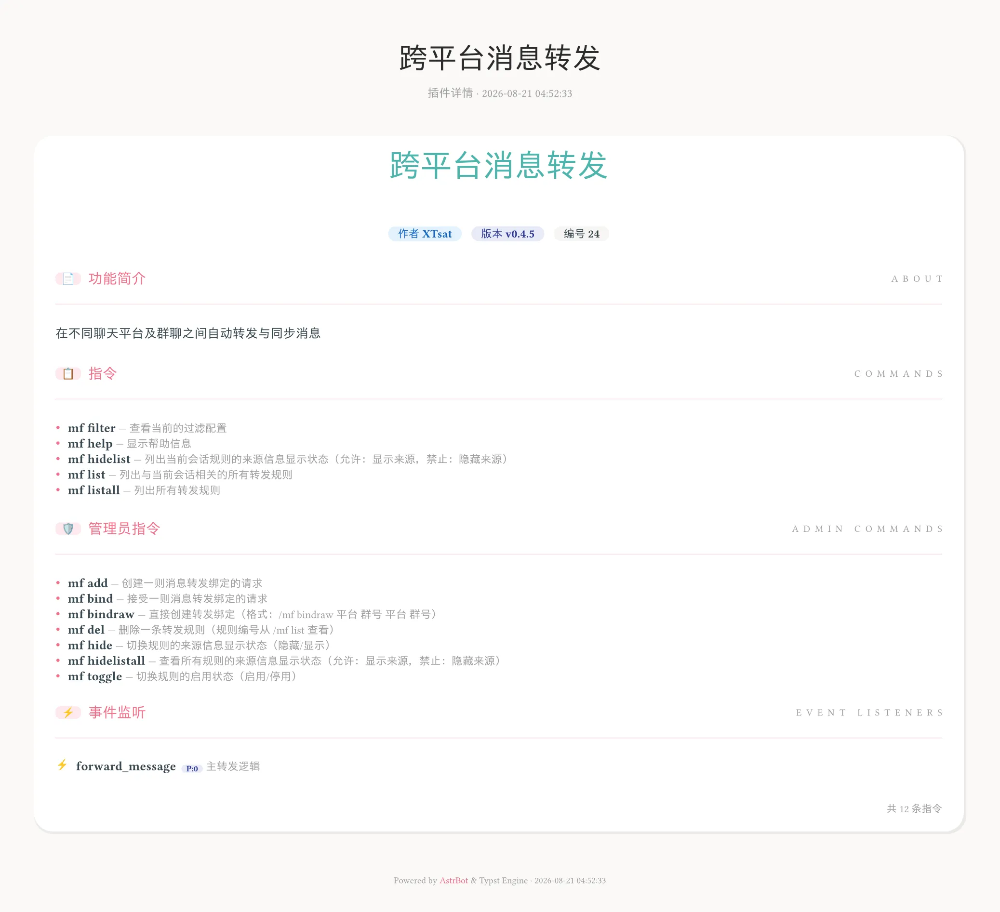
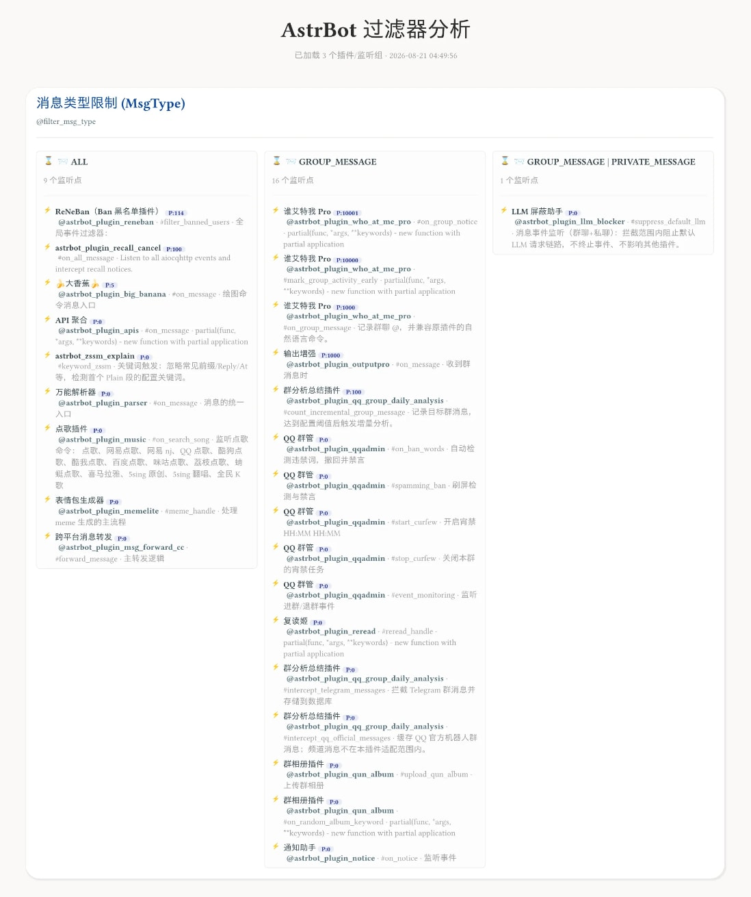
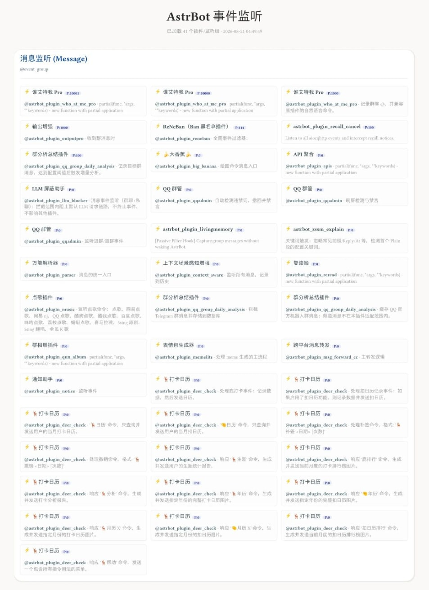
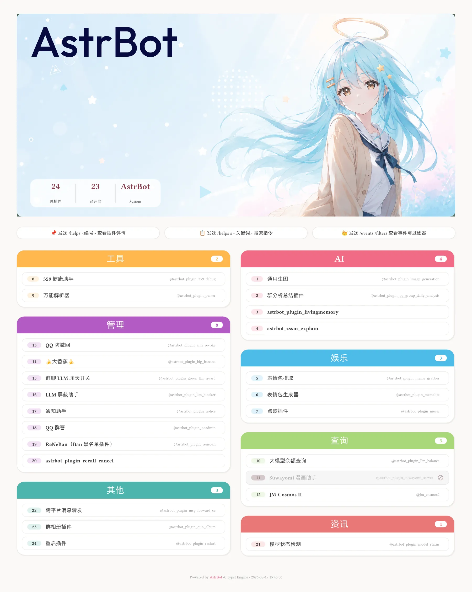

# 📂︎ Astrbot Plugin Help Panel Typst | 插件帮助面板

把 AstrBot 的插件与指令、事件监听、函数工具、过滤器渲染成一张卡片式长图：分类卡片 + 全局编号、Hero 品牌横幅、5 套内置主题、关键词搜索与高亮。

> 基于 [bylkuse/astrbot_plugin_help_typst](https://github.com/bylkuse/astrbot_plugin_help_typst) 特化修改。

---

## ✨ 功能

- **卡片式帮助面板**：`/helps` 采用现代 Bot Dashboard 风格——顶部 Header 卡片（标题 + 统计）与快捷操作按钮，主体为双栏分类卡片，每个分类一张固定主题色卡片（彩色标题栏 + 插件列表 + 编号徽章）。
- **详细帮助模式**：`/helpss` 在每个插件条目下方展开该插件的所有指令标签组（指令名、别名、参数占位符），自动换行，形成「分类 → 插件 → 指令」三级信息层次。
- **插件详情页**：`/helps <编号>` 查看单个插件的作者、版本、功能简介、管理员指令、普通指令与事件监听。
- **关键词搜索**：按插件名、指令名、别名、参数占位符与描述内容搜索（`s <关键词>`），命中的关键词高亮显示。
- **事件监听与过滤器**：`/events` 按事件类型分组列出监听器与函数工具（含 MCP 工具），`/filters` 按过滤器类型分组展示，同样支持搜索。
- **Hero 品牌横幅**：默认开启，把图片放入背景目录后，`/helps` 顶部变为 Hero 横幅——左上官方 AstrBot 文字徽标、左下统计卡片（总插件 / 已开启 / 当前人格名）、右侧背景图角色主视觉；关闭或没有背景图时保持经典布局。
- **5 套内置主题**：`Ocean Blue`、`Night Navy`、`Soft Mist`、`Vivid Pop`、`zhenxun` 在配置面板一键切换，品牌色板与分类色随之变化；也可自定义配色条目。
- **可视化配置分类**：按插件元信息中的关键词自动归类，分类名称、关键词、主题色都能在设置面板里改。
- **自定义字体**：支持 `.ttf/.otf/.woff2`，放入字体目录后经面板重载、重启 AstrBot 或 `/typst font` 指令生效；新字体出现在配置面板的字体顺序里供勾选，不可用字体会自动剔除，系统字体库也会自动扫描。表情字体已固定启用，无需（也无法）在选择框中选择。
- **自动切片**：面板高到超过 WebP 单图上限时，自动切成多张依次发送。
- **可调页面宽度与自动单列**：面板总宽度可调（默认 540pt，可调范围 360~1200pt），分栏列宽随之等比变化；调到「单列切换阈值」以下时自动改为单列，窄页宽下文字相对更大，手机聊天窗口里更容易看清。
- **插件双行模式**：可切换插件行的排版，把右侧的英文 ID（`@xxx`）移到中文名下方排成两行，窄页宽或插件名很长时名称和 ID 不会互相挤压。

### 🖼️ 功能预览

| `插件菜单` | `搜索` |
| :---: | :---: |
|  | </br> |

| `过滤器` | `事件监听器` |
| :---: | :---: |
|  |  |

### Hero 品牌横幅



---

## 📖 指令

### 基本用法

| 命令 | 权限 | 说明 |
| :--- | :--- | :--- |
| `/helps` | 所有人 | 显示插件卡片式帮助面板 |
| `/helps <编号>` | 所有人 | 查看指定插件的详情页（作者 / 版本 / 简介 / 管理员指令 / 普通指令 / 事件监听） |
| `/helps s <关键词>` | 所有人 | 搜索插件与指令，命中的关键词高亮 |
| `/helpss` | 所有人 | 详细帮助面板：每个插件条目下方展示该插件的指令标签组（含别名、参数占位符） |
| `/helpss <编号>` | 所有人 | 详细面板下的插件详情页 |
| `/helpss s <关键词>` | 所有人 | 详细面板下的搜索 |
| `/events` | 所有人 | 事件监听列表（含函数工具与 MCP 工具） |
| `/events s <关键词>` | 所有人 | 搜索事件监听 |
| `/filters` | 所有人 | 过滤器详情列表 |
| `/filters s <关键词>` | 所有人 | 搜索过滤器 |
| `/typst font` | 管理员 | 扫描字体并重载插件 |

> 查看详情请直接用 `/helps <编号>`（编号取自面板上的徽章）；`s <关键词>` 一律按关键词搜索处理，即使关键词是纯数字（如 `/helps s 2048`）也不会跳到编号详情。

### 别名

| 主指令 | 别名（效果等同） |
| :--- | :--- |
| `/helps` | `/帮助`、`/菜单`、`/功能` |
| `/helpss` | `/详细帮助`、`/详细功能`、`/详细菜单` |
| `/events` | `/事件`、`/事件监听` |
| `/filters` | `/过滤器`、`/过滤` |

### 使用示例

```
/helps              # 打开帮助面板
/helps 12           # 看编号 12 的插件详情
/helps s 天气        # 搜索「天气」相关插件与指令
/helpss s image     # 在详细面板里搜索 image，并展开指令标签
/events s llm       # 搜索 LLM 相关事件监听
/typst font         # 管理员：重新扫描字体并重载插件
```

---

## ⚙️ 配置

配置面板位于 AstrBot WebUI 的插件设置中。以下默认值与面板一致。

### 基础

| 配置项 | 类型 | 默认值 | 说明 |
| :--- | :--- | :--- | :--- |
| 等待提示（`enable_waiting_message`） | bool | 关闭 | 开启后生成图片时先发一条「正在渲染…」，图片发出后自动撤回 |
| 屏蔽插件（`ignored_plugins`） | list | 见面板 | 不希望在面板中展示的插件，填写插件的 `name`（如 `astrbot_plugin_xxx`） |
| 自定义字体目录（`custom_font_path`） | string | 空 | 绝对路径，留空时使用数据目录下的 `fonts`；支持 `~` |

### 渲染

| 配置项 | 类型 | 默认值 | 说明 |
| :--- | :--- | :--- | :--- |
| 图片清晰度（`ppi`） | float | 256 | 越高越清晰，但图片更大、渲染更慢；可调范围 72~384，调低可以显著减小图片体积 |
| 页面总宽度（`page_width`） | float | 540 | 整张面板的宽度（pt，可调 360~1200），分栏列宽随它等比变化；调窄后文字相对更大，手机上看更清楚 |
| 单列切换阈值（`single_column_threshold`） | float | 480 | 页面总宽度低于该值时改为单列排版，避免分栏过窄挤在一起 |
| 插件双行模式（`plugin_two_lines`） | bool | true | 开启后把插件行右侧的英文 ID 移到中文名下方排成两行，窄页宽下更整齐 |
| 数据结构超时（`timeout_analysis`） | float | 10 | 生成面板数据的超时时间（秒），插件很多时可适当调大 |
| 编译超时（`timeout_compile`） | float | 30 | 生成图片的超时时间（秒），超时会提示稍后重试 |
| 最大并发编译（`max_concurrent_tasks`） | int | 2 | 同时进行的图片生成任务数量上限，按 CPU 能力调整 |
| WebP 单图高度上限（`webp_limit`） | int | 16383 | 图片超过该高度会自动切成多张，通常无需修改 |
| 切片单位高度（`split_height`） | int | 16000 | 超高图切分时的单位高度 |
| 独占行高度阈值（`giant_threshold`） | int | 1500 | 事件 / 过滤器面板中，超过该高度的卡片独占一行显示 |

### 外观

| 配置项 | 类型 | 默认值 | 说明 |
| :--- | :--- | :--- | :--- |
| 主题预设（`active_preset`） | string | `zhenxun` | 选择内置主题；选「自定义」时使用下方列表里的配色 |
| 字体顺序（`font_order`） | list | 内置字体 | 全局字体使用顺序，可多选排序；选项自动收录内置 / 自定义目录 / 系统字体 |
| 重新扫描字体（`rescan_fonts`） | bool | 关闭 | 勾选并保存后，插件重载时自动扫描一次字体并刷新字体选项，随后自动关闭本开关 |
| 配色列表（`presets`） | 模板列表 | 5 套内置 + 自定义 | 列表式配色编辑，可改主题色、卡片色、标签色等 49 个颜色项 |

> 内置预设的配色是固定的：直接修改内置预设条目的颜色不会生效，需要勾选该条目的「启用」或切换到「自定义」后再改。

### 插件分类规则（`category`）

`/helps` 按插件元信息（名称、描述）中的关键词自动归类：命中第一条匹配的规则即归入该分类，全部未命中则归入兜底分类。

- **分类规则列表**（`rules`）：每个条目 = 分类名称 + 匹配关键词 + 启用开关 + 主题色。列表顺序即匹配优先级（命中第一个即归入）；关键词大小写不敏感、支持中英文；关闭「启用」可临时停用某条规则而不必删除。
- **兜底分类**（`fallback`）与**兜底分类颜色**（`fallback_color`）：独立于规则列表**单独列出、始终存在**，未命中任何关键词的插件统一归入，默认「其他」。
- **分类主题色**：分类卡片标题栏从**主题色槽**取色（`cat_slot_0`~`cat_slot_9` 共 10 个，在主题预设中可单独调色，切换主题自动换色）。三种取值——填 `slot_0`~`slot_9` **绑定主题色槽**；填 `#RRGGBB` **固定颜色**（不随主题变化）；**留空**自动按列表顺序分配主题色槽。

| 分类 | 默认槽位 | 匹配关键词 |
| :--- | :--- | :--- |
| AI | `slot_1`（粉 `#F16B86`） | llm、模型、gpt、大模型、对话、智能、画图、绘图、文生图、图像、绘画、image、diffusion |
| 查询 | `slot_2`（浅绿 `#A8D77A`） | 查询、搜索、百科、词典、翻译、天气、汇率、快递、新闻、热搜、日历、黄历、search、query、wiki、translate、weather |
| 工具 | `slot_3`（橙 `#FFB84D`） | 工具、计算、转换、二维码、短链、短网址、解析、压缩、编码、tool、qrcode、聚合、网盘 |
| 管理 | `slot_4`（紫 `#B45BC5`） | 管理、群管、禁言、踢人、审核、权限、撤回、违禁词、黑名单、风控、admin |
| 娱乐 | `slot_5`（天蓝 `#4DBCE8`） | 娱乐、游戏、抽奖、点歌、音乐、笑话、梗图、表情包、随机、运势、签到、塔罗、占卜、骰子、game、music |
| 资讯 | `slot_6`（珊瑚红 `#E97878`） | 资讯、订阅、推送、通知、提醒、播报、监控、rss、news、feed |
| 调试 | `slot_7`（玫粉 `#F36F88`） | 调试、开发、测试、日志、诊断、debug、dev |
| 其他 | `slot_0`（青绿 `#4DB5AD`） | 兜底：未命中任何关键词时归入 |

### 顶部 Hero 品牌横幅

`/helps` 顶部支持 **Hero 品牌模式**（`hero_header`，**默认开启**）：检测到背景图后，顶部变为 Hero 横幅——左上为**官方 AstrBot 文字徽标**，**左下为半透明白色统计卡片**（总插件 / 已开启，数字与标签整体垂直居中；第三列自动显示**当前人格名称**，未配置人格时不显示该列），**右侧预留给背景图角色主视觉**，整卡按图片原始比例展示背景；关闭 `hero_header` 或没有背景图时恢复经典白色卡片布局。

背景图放在**背景目录**中，插件只扫描该目录根下的图片（`.png/.jpg/.jpeg/.webp/.gif`，排除 `cache_`、`temp_` 开头的文件）。目录来源：

1. **自定义背景目录**（`background_dir`）：配置为绝对路径（优先）。
2. **默认背景目录**（推荐）：缺省 `.../data/plugin_data/astrbot_plugin_help_panel_typst/backgrounds`，直接把图片放进去即可，无需配置。

> 插件安装时，`resources/images/` 中的内置图片（`.png/.jpg/.jpeg/.webp/.gif` 格式）**自动导入**到默认背景目录；已存在的文件不会被覆盖，之后可自行替换或增删。

可选配置：

- 背景图随机选择（`background_random`，**默认开启**）：每次渲染从背景目录**随机选一张**；关闭时取文件名排序第一张。
- 指定背景图（`header_background`）：显式指定单个图片文件的绝对路径，优先级最高，设置后直接使用该图。
- Hero 品牌模式（`hero_header`）：Hero 横幅开关（默认开启）。

说明：

- 背景图变更（新增 / 删除 / 替换）会自动触发重新生成，无需手动清理。
- 横幅文字颜色会自动压深以保证在浅色背景图上可读（不受深色主题影响）。

### 字体

字体优先级：**文档显式指定 > 项目字体目录 > 系统字体库**

- 文档显式指定：模板中直接指定字体名，优先级最高。
- 项目字体目录：插件目录下的 `resources/fonts`，以及**自定义字体目录**（`custom_font_path`；留空为数据目录下的 `fonts`）。🚨 Docker 用户请确保自定义字体目录已挂载。
- 系统字体库：自动扫描并收录进「字体顺序」选择框（Windows `C:/Windows/Fonts`；macOS `/System/Library/Fonts`、`/Library/Fonts`、`~/Library/Fonts`；Linux `/usr/share/fonts`、`/usr/local/share/fonts` 等）。🚨 Docker 环境可能没有系统字体，需要把字体放入自定义字体目录或安装字体依赖。

> 渲染时会同时加载系统字体库与自定义目录的字体，选系统字体同样能正常生效。放进新字体后如果选择框里没有，可勾选「重新扫描字体」保存，或手动执行 `/typst font`。
>
> 🎨 表情字体（Noto Color Emoji）固定启用，始终追加在字体列表末尾用于渲染彩色 emoji，**不出现在字体选择框中**。

---

## 📦 安装与依赖

1. 在 AstrBot 插件市场搜索 **插件帮助面板** 安装，或把仓库放到 `data/plugins/astrbot_plugin_help_panel_typst`；
2. 重启 AstrBot（或在插件管理里重载），插件会自动安装依赖并导入内置背景图；
3. 发送 `/helps` 查看面板。

**运行环境**

| 项目 | 要求 |
| :--- | :--- |
| AstrBot | `>= 4.9.2`（见 `metadata.yaml`） |
| Python | 随 AstrBot 环境（代码兼容 3.10 语法，实际上游要求 3.12+） |
| 依赖 | `typst >= 0.14.7`、`pydantic`（见 `requirements.txt`）；Pillow 由 AstrBot 环境提供 |
| 网络 | 首次安装需能拉取依赖；渲染在本机完成，不需要联网 |

**卸载**：从插件目录删除即可，数据目录下的字体、背景图与缓存不会被自动删除，可手动清理。

---

## ❓ 常见问题

**Q：面板图片被切成好几张，能合成一张吗？**
图片高度超过 WebP 单图上限（16383 像素）时会自动切分发送，这是 WebP 格式限制导致的。想减少张数可以调低「图片清晰度（`ppi`）」。

**Q：面板图在手机聊天窗口里必须点「查看原图」才清楚，怎么办？**
聊天软件会先把大图压成缩略图显示，「查看原图」是聊天软件自己的行为，插件无法强制它显示原图。可以从尺寸入手让图片更贴近手机屏幕：调窄「页面总宽度（`page_width`）」（例如 500~600），配合合适的「图片清晰度（`ppi`）」——宽度太窄会被放大发糊，太宽又会被压缩。页宽调到「单列切换阈值（`single_column_threshold`）」以下后自动变单列，文字会更大。窄页宽会让长图变长，必要时再用「WebP 单图高度上限（`webp_limit`）」和「切片单位高度（`split_height`）」控制切分。

**Q：为什么每次都要重新渲染，没有秒开？**
开启「背景图随机选择」时，每次可能换一张背景图，图片需要重新生成；想要秒开可以关闭随机、或直接指定单张背景图（`header_background`）。分类规则、主题、字体、背景图等配置变化后也会自动重新生成。

**Q：图片上的时间是发送时间吗？**
是这张图的**生成时间**。如果直接复用了上次生成的结果，显示的就是上次生成的时间。

**Q：为什么事件 / 过滤器面板里少了个插件的监听？**
事件与过滤器面板只列出已启用插件的监听；命令面板（`/helps`、`/helpss`）里已禁用的插件会以灰化样式显示，方便发现「装了但没启用」。如果本就不想让某个插件出现在任何面板，把它加入「屏蔽插件（`ignored_plugins`）」。

**Q：快捷操作按钮里的指令前缀和我的不一样？**
按钮上的指令会跟随 AstrBot 的唤醒词配置（`wake_prefix`）显示，例如把唤醒词改成 `!` 后按钮会显示 `!helps`。

**Q：事件面板里出现「其他事件」分组是什么？**
当某个事件类型不在内置事件类型表里（通常是 AstrBot 新版本新增了事件类型）时，会归入「其他事件」。升级插件后一般会恢复正常分类。

**Q：提示「渲染失败」或「渲染超时」怎么办？**
先确认配置的字体文件没有损坏、背景图格式是 `.png/.jpg/.jpeg/.webp/.gif`；插件很多时可以调大「编译超时（`timeout_compile`）」或调低「图片清晰度（`ppi`）」。详细原因会记录在 AstrBot 日志中（前缀 `[HelpTypst]`）。

**Q：配置文件被改坏了，插件起不来？**
渲染相关配置项现在都做了类型与范围收敛：非法值会回落到默认值，不会导致插件加载失败。

---

## 📄 许可证与鸣谢

- 许可证：[AGPL-3.0](./LICENSE)
- 鸣谢：[bylkuse/astrbot_plugin_help_typst](https://github.com/bylkuse/astrbot_plugin_help_typst)（Typst 版帮助面板）、以及所有依赖项目的作者。
